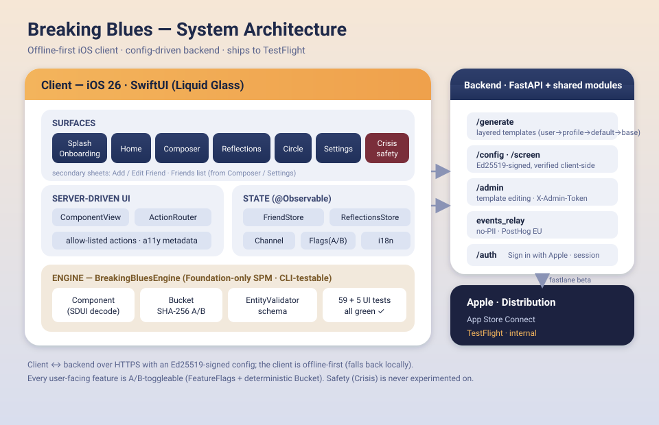
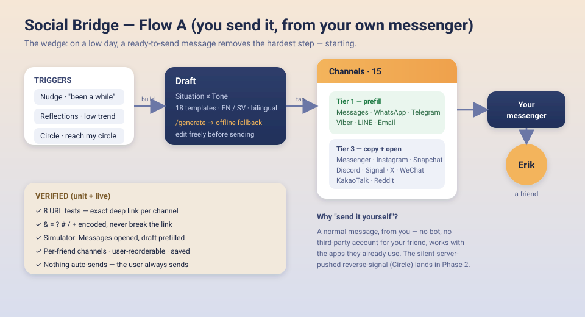
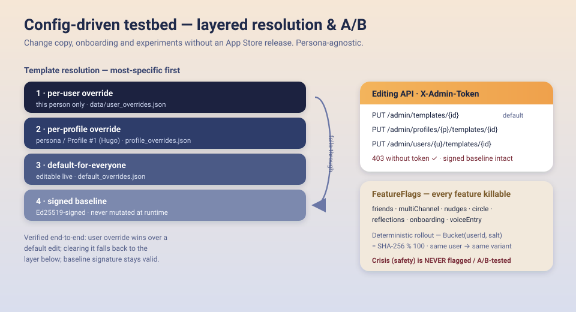

# Breaking Blues — Architecture

A universal, **config-driven behavioural testbed** shipped as a warm, offline-first iOS app.
The first configuration ("Profile #1 = Hugo") targets young men 18–30 in Sweden with recurrent
low periods and social withdrawal. The wedge is the **Social Bridge**: on a hard day, give the
user a ready-to-send message to a friend — from their own messenger.

---

## 1 · System

Offline-first SwiftUI client · a config-driven FastAPI backend that can change copy, onboarding
and experiments **without an App Store release** · shipped to TestFlight.

**Layers**

- **Surfaces** — Splash · Onboarding · Home · Composer · Add/Edit Friend · Reflections · Circle ·
  Settings · Friends · Crisis. Native iOS 26 (Liquid Glass on the nav layer), WCAG AA on every screen.
- **Server-driven UI** — a closed `Component` enum renders layout-as-data; `ActionRouter` only ever
  triggers allow-listed actions (never arbitrary URLs/code). Config carries a11y metadata.
- **State** — `@Observable` stores (Friends, Reflections, ChannelOrder, FeatureFlags, Localization),
  persisted locally; CloudKit sync later. Friends carry a **relationship** (friend / family) that
  shifts tone and suggestions.
- **On-device signals** — `CalendarService` (EventKit) reads upcoming plans locally and the pure
  `CalendarPlans` logic matches them to people in the hub; `ActivityCatalog` offers relationship-aware
  activity suggestions. Nothing leaves the device.
- **Engine** — `BreakingBluesEngine`, a Foundation-only SwiftPM package (CLI-testable): `Component`
  decode, deterministic `Bucket` (A/B), `EntityValidator`. **14 engine + 45 app unit tests + 5 UI-flow
  tests, all green.**
- **Backend** — FastAPI + shared modules: `/generate` (layered templates), `/config` &
  `/screen` (Ed25519-signed), `/admin` (template editing), `events_relay` (no-PII, PostHog EU),
  `/auth` (Sign in with Apple). The backend is an **enhancement layer, never a hard dependency** —
  the core loop runs fully offline.

---

## 2 · Social Bridge — Flow A

The user always sends the message themselves, from an app they already use. Nothing auto-sends.

- **Triggers** — a gentle Nudge ("it's been a while with Erik"), the Reflections early-warning
  (a low check-in trend), an **upcoming calendar plan** ("you have plans with Erik tomorrow"), or
  Circle ("ask my circle to reach out"). The plan reminder takes priority when present.
- **Draft** — Situation × Tone → one of 18 bilingual (EN/SV) templates via `/generate`, with an
  offline fallback so a draft always appears; fully editable before sending. A **"suggest an
  activity"** row (coffee · walk · call · … tuned by friend/family) drops a ready invitation opener
  into the draft.
- **15 messengers** — popularity-ordered, user-reorderable and saved: Messages, WhatsApp, Telegram,
  Viber, LINE, Email, Messenger, Instagram, Snapchat, Discord, Signal, X, WeChat, KakaoTalk, Reddit.
  Each opens with the message ready, or (where an app has no direct prefill) copies it and opens the
  app to paste.
- **Verified** — 8 URL tests assert the exact deep link per channel (special characters encoded so
  they never break the link); on the simulator, `sms:` opened Messages with the draft prefilled.

---

## 3 · Config-driven testbed

Everything that isn't safety is A/B-toggleable and remotely editable.

- **Layered templates** — resolution is most-specific-first: **per-user → per-profile →
  default-for-everyone → signed baseline**. A per-user override wins over a global edit; clearing it
  falls back to the layer below; the signed baseline is never mutated (config-signing stays intact).
- **Editing API** — `PUT/DELETE /admin/templates|profiles|users/...`, guarded by `X-Admin-Token`
  (403 without it, verified).
- **FeatureFlags** — one enum case per feature (`friends`, `multiChannel`, `nudges`, `circle`,
  `reflections`, `onboarding`, `voiceEntry`, `familyRelationship`, `activitySuggestions`,
  `calendarPlans`); deterministic rollout via `Bucket(userId, salt)` so a user stays in a stable
  variant. **Crisis is never flagged or experimented on.**

---

## Ship status

- **App Store Connect** app `com.agonist.breakingblues`.
- **TestFlight** — internal (no review).
- **Tests** — 59 unit (14 engine + 45 app: stores · channel URLs · nudge · localization · relationship ·
  calendar plans · activities) + 5 UI-flow tests (relationship picker · activity suggestion · plan
  nudge), all green.
- **Repo** — this repository (course group).
