# Breaking Blues — Design Spec (build brief)

Treat this like the Figma hand-off before development. Each frame below is a **mockup +
build brief**: what the surface is for, the components it contains, its interactions and
states, and the functions/data to implement. Design bar: high-craft, native iOS feel;
WCAG AA on every screen. Palette: Dawn gradient background, deep-navy cards, warm amber
accent (`#F0B45C`), safety red for Crisis.

> The images are the current running app (iOS 26 simulator) used as reference mockups.

---

## 0 · Surface architecture

Hub-and-sheets, **no tab bar**: Splash → (first launch) Onboarding → **Home** as the hub;
every other surface presents as a sheet over Home. Crisis is always reachable.

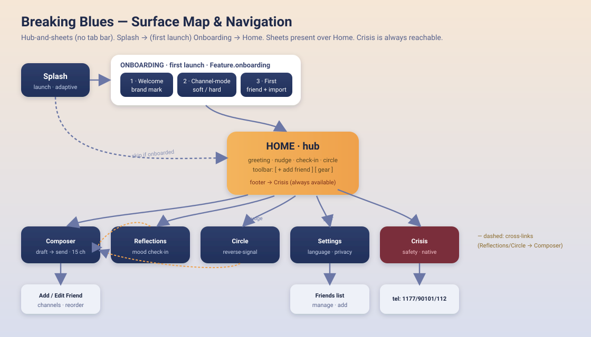

**Routing contract**

- `RootView` gates: `Splash` → if `!onboarding.hasCompleted && Feature.onboarding` → `Onboarding`, else `Home`.
- Home owns an `ActionRouter` with an `AppSheet` enum: `compose · reflections · circle · settings · friends · addFriend · editFriend · crisis`.
- Deep-link for QA/screenshots: `BB_SCREEN=<surface>` (+ `BB_STEP`, `BB_SEED`, `BB_LANG`).
- Every feature is A/B-toggleable via `FeatureFlags`; **Crisis is never flagged**.

---

## Frame 1 · Splash

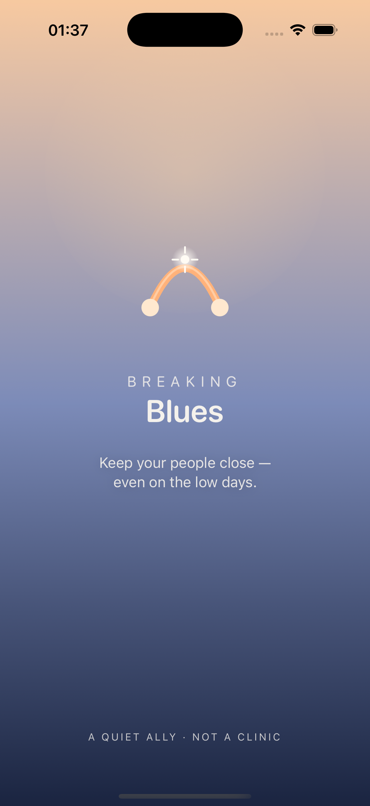
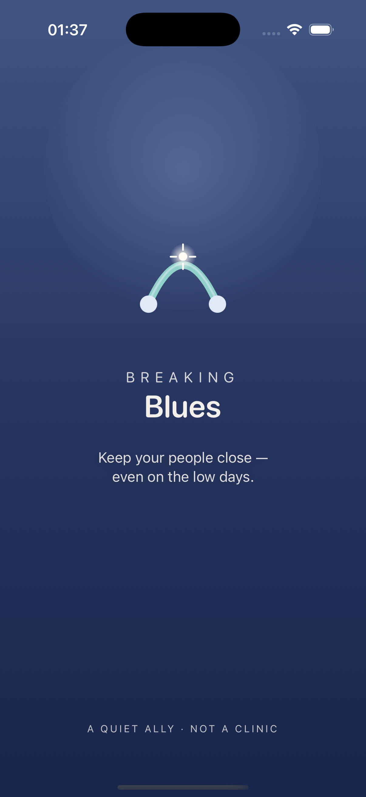

- **Purpose** — warm launch; establish the brand mark (arch + two nodes + spark = the Social Bridge).
- **Components** — adaptive gradient (Dawn/Night by color scheme) · `BridgeMark` · wordmark "Breaking / Blues" · tagline · footer "a quiet ally · not a clinic".
- **Interactions** — auto-advance after ~1.8s (0.4s with Reduce Motion); BridgeMark spring pop-in; radial "breathing" glow (disabled under Reduce Motion).
- **States** — light vs dark appearance; Reduce-Motion variant.
- **Functions** — `RootView` timed transition; skip when `BB_SCREEN != splash`.
- **A11y** — single combined VoiceOver label; Dynamic Type; AA contrast over the gradient.

---

## Frame 2 · Onboarding (3 steps)

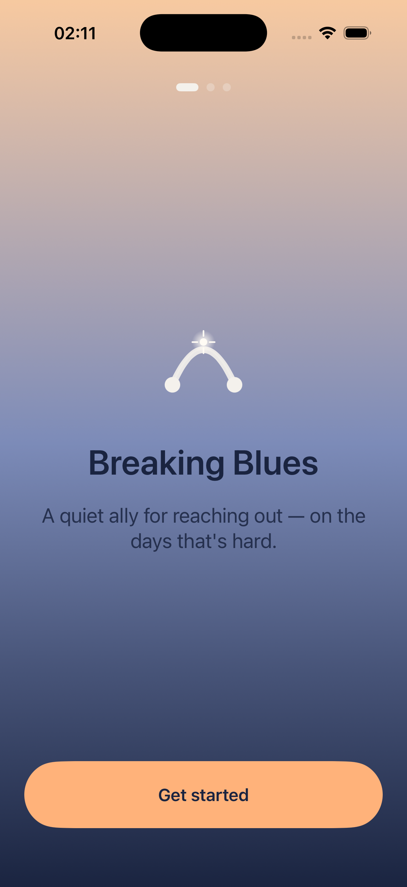
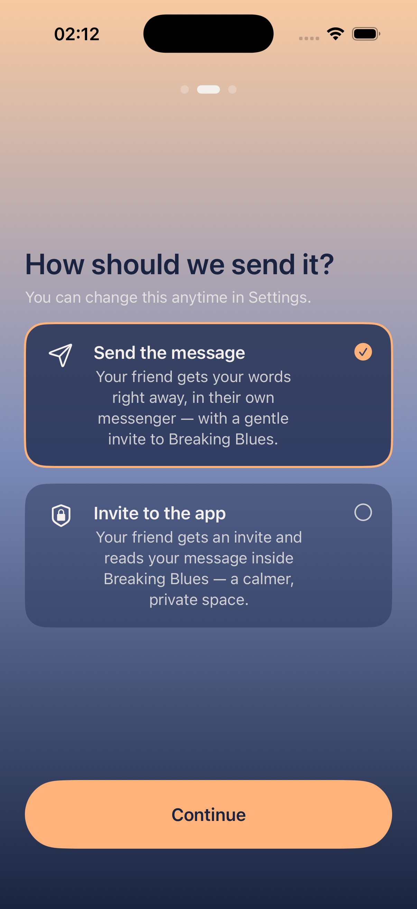
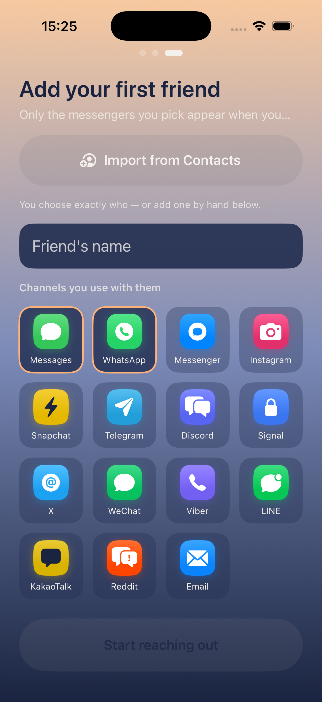

- **Purpose** — set the channel-mode preference and add the first friend so the Social Bridge works immediately.
- **Components** — progress dots · Step 1 welcome (BridgeMark) · Step 2 two selectable mode cards (soft = "Send the message" / hard = "Invite to the app") · Step 3 name field + "Import from Contacts" + channel multi-select (app-icon badges) · primary button.
- **Interactions** — paged advance with opacity transition; mode select = border + checkmark + haptic; channel toggle; **Import from Contacts** → iOS 18 `contactAccessPicker` (limited access; device-only) maps contacts → friends.
- **States** — per step; primary button disabled until the step is valid (name + ≥1 channel on step 3).
- **Functions** — `OnboardingState.setMode` + `.complete()` (persisted); `FriendStore.add`; `ContactImporter.friends(for:)`.
- **A11y** — selection not colour-only; name field is an opaque dark card with a readable placeholder; labelled `.isSelected` controls.

---

## Frame 3 · Home (hub)

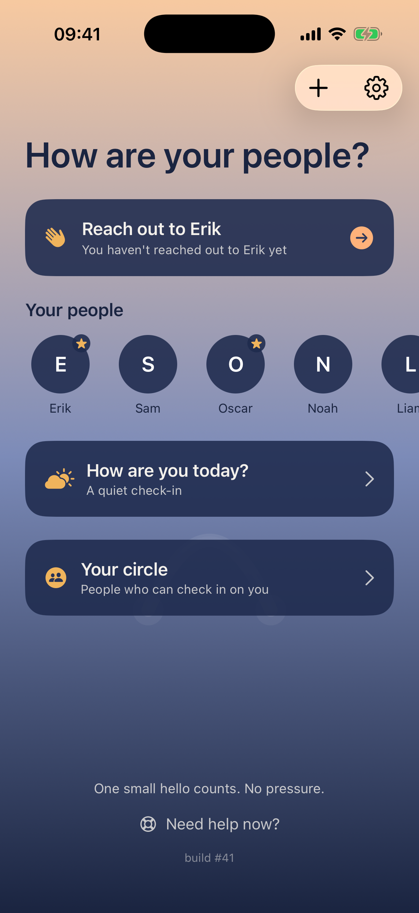

- **Purpose** — calm hub; surface the single most useful next action.
- **Components** — large greeting · **Nudge card** ("Reach out to {friend}") · **Your people** row (avatars of everyone in the hub — tap to message; a house badge = family, a star badge = in your Circle; `+` adds someone) · **Check-in card** → Reflections · **Circle card** → Circle · faint BridgeMark watermark · reassurance line · Crisis link · toolbar `[ + add friend ]` `[ gear → Settings ]` (Liquid Glass).
- **Interactions** — nudge → Composer with that friend preselected; card press = spring scale + soft haptic; toolbar `+` → Add Friend, gear → Settings.
- **States** — with/without an active nudge (falls back to the server-driven card); flags off → hide the corresponding card. The nudge has a priority order: an **upcoming calendar plan** ("You have plans with {friend} tomorrow") wins over the time-based / low-trend nudge.
- **Functions** — `CalendarPlans.reminder(friends:events:now:)` over on-device events from `CalendarService` (EventKit, gated by `Feature.calendarPlans`); else `NudgeEngine.top(friends:now:boosted:)` (boosted by Reflections low-trend); `ConfigProvider` renders the signed fallback card; `Feature.nudges/reflections/circle` gate the cards.

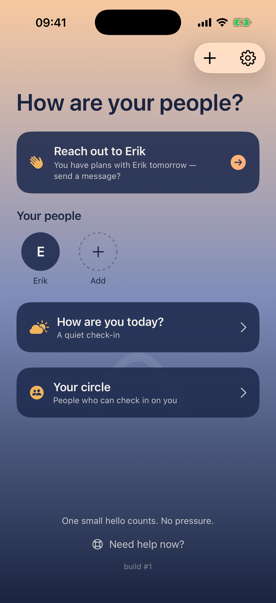
- **A11y** — cards white-on-navy; focus order header → nudge → check-in → circle → crisis; ≥44pt targets.

---

## Frame 4 · Draft Composer (Social Bridge, Flow A)

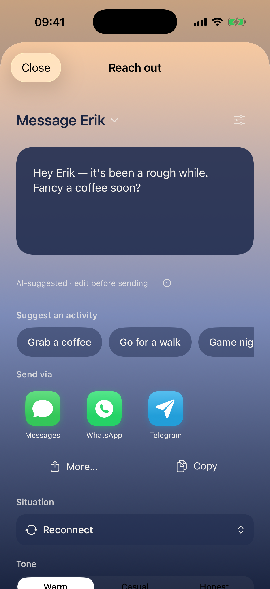

- **Purpose** — hand the user a ready-to-send message and open their own messenger. Nothing auto-sends.
- **Components** — friend menu ("Message {name} ⌄") + edit-channels button · editable draft card · "edit before sending" note + ⓘ · **Suggest an activity** row (relationship-aware chips: coffee · walk · call · …) · **Send via** grid of app-icon channel badges (friend's channels, user-ordered) · More… (share sheet) · Copy · **Situation** menu (6) · **Tone** segmented (Warm/Casual/Honest).
- **Interactions** — Situation × Tone regenerate the draft; an activity chip drops a ready invitation opener into the draft (manual override, toast); badge tap → `channel.url(forMessage:)` opens the app prefilled, or (where an app has no direct prefill) copies the draft and opens the app to paste (toast, no layout shift); friend menu switches/adds; edit-channels → Add/Edit Friend.
- **States** — loading ("Finding the words…"); empty channels → "Add channels for {name}"; toast on copy / on activity added.
- **Functions** — `APIClient.generate(templateId:variables:locale:)` (offline fallback); `ActivityCatalog.suggestions(for:)` (tuned by `Friend.relationship`, gated by `Feature.activitySuggestions`); `Channel.all` (15, popularity + user reorder); `ChannelOrderStore`; `FriendStore.markReachedOut`.
- **A11y** — per-channel label + hint; auto dark-glyph on light tiles (Snapchat/KakaoTalk) for contrast; ≥44pt.

---

## Frame 5 · Add / Edit Friend

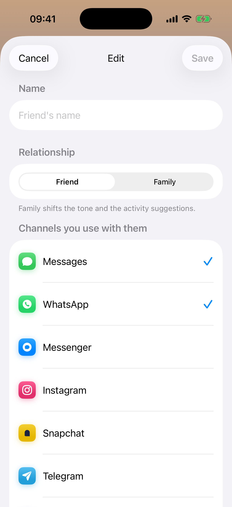

- **Purpose** — capture a friend, whether they're a peer or family, and the channels used with them.
- **Components** — name field · **Relationship** segmented picker (Friend / Family) · channel rows (app-icon badge + name + selection check) · EditButton (drag-to-reorder) · Save/Cancel.
- **Interactions** — tap toggles a channel; the relationship picker shifts tone + activity suggestions; Edit mode drags to reorder (persists globally via `ChannelOrderStore`); Save disabled until name + ≥1 channel.
- **States** — Add (empty) vs Edit (prefilled — present via `.sheet(item:)`, never the add flow). Relationship defaults to Friend; the picker is gated by `Feature.familyRelationship`.
- **Functions** — `FriendStore.add/update`; `Friend.relationship` + channel order persisted (reach-out history and circle membership preserved on edit); friend channels drive the Composer grid.
- **A11y** — labels at label-colour (not accent), blue checkmarks (accent orange fails on white).

---

## Frame 6 · Reflections (mood check-in)

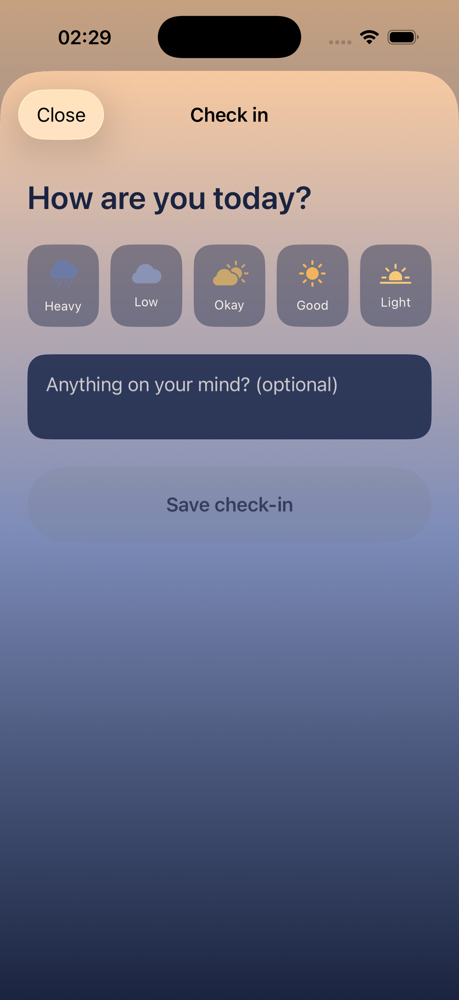

- **Purpose** — a calm, non-clinical check-in; detect a low stretch and gently bridge to reaching out.
- **Components** — "How are you today?" · 5 weather moods (Heavy→Light) · optional note · Save · recent-history strip (no streaks/points) · early-warning card ("It's been a heavy stretch → Message a friend").
- **Interactions** — mood select = spring pop + selection haptic; Save = success haptic + persists; reach-out card → Composer.
- **States** — empty (no history); after save; low-trend → reach-out card visible.
- **Functions** — `ReflectionsStore.add(level:note:at:)` + `.suggestsReachingOut` (last-3 average ≤ 2.2).
- **A11y** — icon + label (not colour-only); note field opaque dark card; `.isSelected` moods.

---

## Frame 7 · Circle (consented reverse-signal)

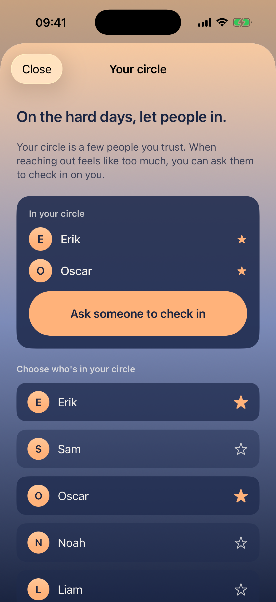

- **Purpose** — the unique wedge: a trusted circle you can ask to check in on you on a hard day.
- **Components** — intro · "In your circle" card (avatar-initial members) · "Ask someone to check in" · "Choose who's in your circle" list (avatar + star toggle).
- **Interactions** — star toggles membership (spring + selection haptic); "Ask" → Composer for a circle member with the rough-day draft.
- **States** — empty (prompt to add) vs populated (ask card).
- **Functions** — `Friend.inCircle`; `FriendStore.setInCircle/circle`. Phase 2: silent server-pushed reverse-signal (accounts + APNs).
- **A11y** — star filled/outline (shape, not colour-only); white-on-navy.

---

## Frame 8 · Settings

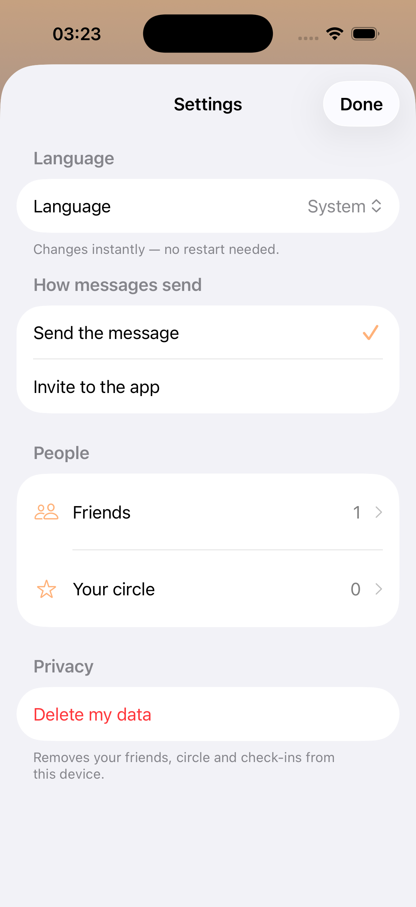

- **Purpose** — language, how messages send, people, privacy.
- **Components** — Language picker (System / English / Svenska) · Channel-mode picker · Friends (→ list) · Your circle (→ Circle) · Delete my data.
- **Interactions** — language switches **live, no restart** (Bundle-swap); delete → confirmation → wipe.
- **States** — EN ↔ SV (endonyms); counts on rows.
- **Functions** — `LocalizationController.set`; `OnboardingState.setMode`; `FriendStore/ReflectionsStore.deleteAll`.
- **A11y** — native Form contrast; destructive styled Delete.

---

## Frame 9 · Friends list

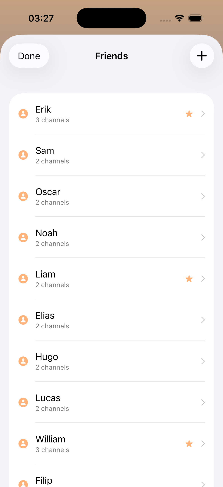

- **Purpose** — manage all friends.
- **Components** — rows (avatar-ish + name + channel count + star if in circle) · `+` add · swipe-to-delete.
- **Interactions** — tap → Edit friend; `+` → Add friend; swipe → remove.
- **Functions** — `FriendStore` CRUD; scales to many friends.

---

## Frame 10 · Crisis (safety — native, never A/B)

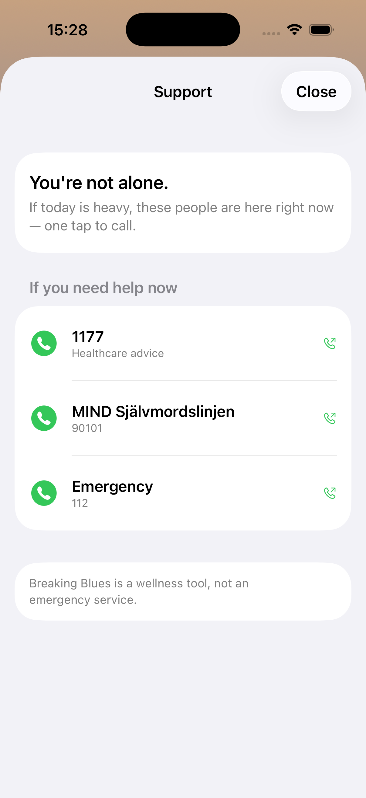

- **Purpose** — always-available safety net; wellness framing, not an emergency service.
- **Components** — "You're not alone" header · call rows (green phone + name + number) for 1177 / MIND 90101 / 112 · disclaimer.
- **Interactions** — one tap → `tel:`; offline; reachable from Home footer in ≤2 taps.
- **States** — static, bundled (works offline).
- **Functions** — bundled numbers (Sweden / Profile #1); **never** part of any experiment.
- **A11y** — black titles (not accent), green call affordance, ≥44pt, per-row hint.

---

## Build order (suggested)

1. Splash + RootView routing · 2. Onboarding · 3. Home hub + ActionRouter · 4. Add/Edit
Friend + FriendStore · 5. Composer + channel delivery · 6. Reflections · 7. Circle · 8.
Settings + Localization · 9. Crisis (safety, first-class from day one). Backend
(`/generate`, signed `/config`, `/admin`, `events_relay`) can land in parallel; the client
is offline-first and never blocks on it.
